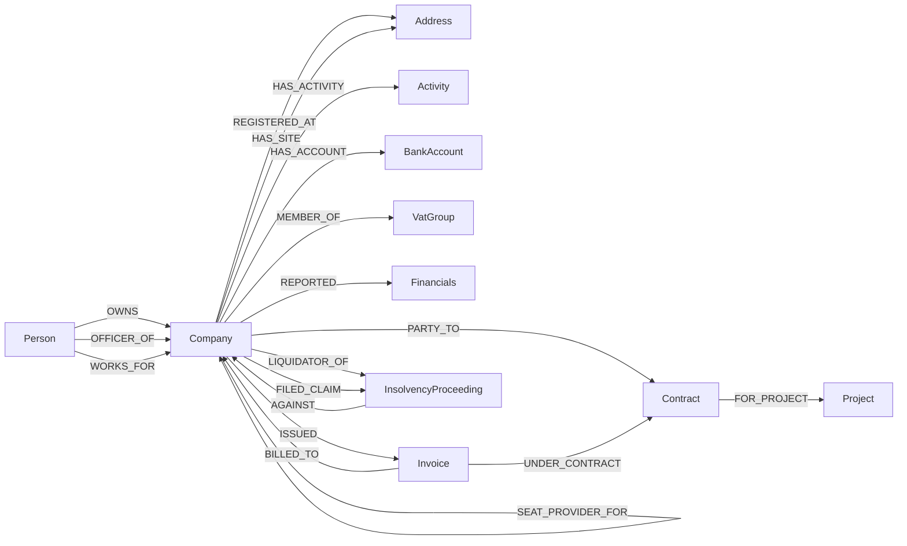
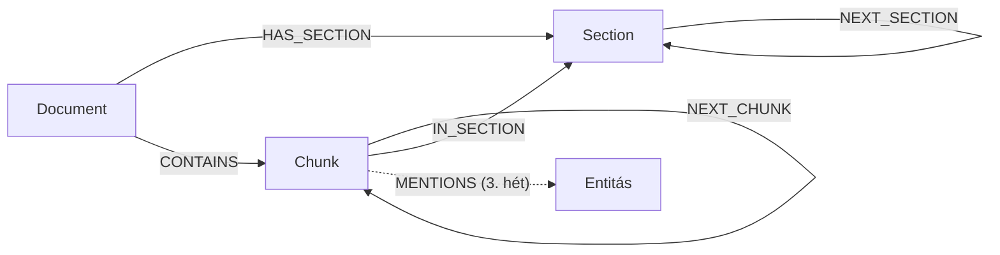

# Gráfséma

A gráf két rétegből áll:

- **Szakterületi gráf:** cégek, személyek, szerződések. Most a seed tölti, a 3. héttől az LLM-es kinyerés.
- **Dokumentumgráf:** dokumentum → szakasz → chunk. Ehhez nem kell extrakció, a korpusz szerkezetéből épül.

A két réteget a 3. héten a `(:Chunk)-[:MENTIONS]->(entitás)` él köti össze.

A séma gépi változata a [`graph.py`](../src/graphrag_course/graph.py)-ban van (`NODE_KEYS`, `REL_TYPES`). A betöltő ez
alapján utasítja el a sémasértő élet, például egy `(:Project)-[:OWNS]->(:Company)` élt.

## Elvek

1. **A kulcs nem a név.** A korpuszban ugyanaz a cég két néven és két adószámmal is szerepel (Tolnaker → Mecsekkő
   Tolna), és két különböző Nagy László is van benne. Ezért:
   - a cég kulcsa a **cégjegyzékszám**;
   - a személyé egy **név + születési dátum** alapú azonosító.
2. **Az idő az élen van.** A tulajdon és a tisztség változik: a Q05, a Q08 és a Q12 éppen erről kérdez. Ezért
   `valid_from` / `valid_to` az élen áll, és üres `valid_to` jelenti, hogy a kapcsolat ma is hatályos. Ha ugyanaz a
   pár két időszakban is kapcsolatban állt, az két külön él, mert az időbeli él azonosítójának része a `valid_from`.
3. **Ami köt, az csomópont. Ami leír, az tulajdonság.** Csomópont lesz, ha:
   - több dolog kapcsolódik hozzá, vagy
   - saját azonosítója és életciklusa van.

   Ami egyetlen dolgot ír le, az tulajdonság. A részletek lent, a [döntési táblában](#tulajdonság-vagy-csomópont).
4. **Adatminimalizálás.** A lakcím nem kerül a gráfba. A névrokonok szétválasztásához a születési dátum és az anyja
   neve elég.
5. **Szakterületi fogalmak, nem PERSON/ORG/GEO.** A „cím” két szerepben jelenik meg, székhelyként és
   telephelyként, és a kettő mást jelent. A „szervezet” is többféle: cég, áfacsoport, felszámolási eljárás.

## Szakterületi gráf

### Csomópont-típusok

| Címke | Fogalom | Kulcs | Fő tulajdonságok | Példa a korpuszból |
|---|---|---|---|---|
| `Company` | cég (gazdálkodó szervezet) | `reg_no` (cégjegyzékszám) | `name`, `full_name`, `aliases[]`, `legal_form`, `tax_number`, `status`, `status_since`, `founded_on` | Kapos-Gép Gépészeti Kft. |
| `Person` | természetes személy | `person_id` | `name`, `birth_date`, `mother_name` | Nagy László (1971) ≠ Nagy László (1985) |
| `Address` | cím (székhely vagy telephely) | `address` (kanonikus alak) | `postal_code`, `city` | 7621 Pécs, Széchenyi tér 4. |
| `Activity` | tevékenység (TEÁOR) | `code` | `name` | 4322 Víz-, gáz-, fűtésszerelés |
| `BankAccount` | pénzforgalmi számla | `number` | `bank`, `opened_on` | 99891798-… |
| `VatGroup` | áfacsoport | `group_tax_id` (csoportazonosító) | `name` | 99986045-5-02 |
| `Contract` | szerződés | `contract_id` | `contract_type`, `title`, `signed_on`, `valid_from`, `valid_to`, `net_value_huf`, `deadline`, `status`, `terminated_on` | Balokány B–C alvállalkozói szerződés |
| `Project` | építési projekt | `project_id` | `name`, `city` | Balokány Lakópark |
| `Invoice` | számla | `invoice_id` (kiállító cégjegyzékszáma + sorszám) | `number`, `invoice_type`, `issued_on`, `net_amount_huf`, `vat` | KG-2025/014 |
| `InsolvencyProceeding` | fizetésképtelenségi eljárás | `case_no` (ügyszám) | `kind`, `court`, `started_on` | Fpk.02-25-000318 |
| `Financials` | egy év beszámoló-adatai | `financials_id` (cégjegyzékszám + év) | `year`, `revenue_huf`, `net_income_huf`, `headcount` | Dráva Gépészet 2024 |

**Kulcsok:**

- **`person_id`** = a név ékezet nélküli slugja és a születési dátum, például `nagy-laszlo-1971-03-08`. Ahol nincs
  születési dátum (például egy projektvezetőnél), ott a név mellé annak a cégnek a cégjegyzékszáma kerül, amelyik
  kontextusában a személy szerepel. Ez gyengébb azonosítás, és a 3. heti összevonásnál külön kell kezelni.
- **Az adószám nem kulcs,** mert változik: áfacsoportba lépéskor a középső számjegy `-4-` lesz.

### Kapcsolattípusok és irányuk

Az irány mindig olvasható mondat: `(alany)-[:ÁLLÍTMÁNY]->(tárgy)`.

| Él | Irány | Mit jelent az irány | Él-tulajdonságok |
|---|---|---|---|
| `OWNS` | tulajdonos → birtokolt cég (a tulajdonos személy vagy cég) | Az irányítás iránya. Előre bejárva: mit birtokol közvetve. Hátra bejárva: ki áll mögötte (Q10). A hányadok szorzata a lánc mentén adja az effektív részesedést | `share_pct`, `valid_from`*, `valid_to` |
| `OFFICER_OF` | személy → cég | Vezető tisztségviselő, a cégjegyzék szerint | `role`, `representation`, `valid_from`*, `valid_to` |
| `WORKS_FOR` | személy → cég | Nem bejegyzett szerep (projektvezető, kapcsolattartó) | `role` |
| `REGISTERED_AT` | cég → cím | Székhely. A cím befelé mutató fokszáma = hány cég ül ott | `valid_from`, `valid_to` |
| `HAS_SITE` | cég → cím | Telephely vagy fióktelep | `purpose` |
| `SEAT_PROVIDER_FOR` | szolgáltató → ügyfél | Megmagyarázza a közös címet, és megkülönbözteti a valódi kapcsolattól (Q09) | — |
| `HAS_ACTIVITY` | cég → tevékenység | A közös tevékenység versenytársi viszonyt jelez | `main` |
| `HAS_ACCOUNT` | cég → bankszámla | A közös számla erős jel | `opened_on` |
| `MEMBER_OF` | cég → áfacsoport | Csoporttagság. A tag ilyenkor új adószámot kap | `valid_from`*, `valid_to`, `member_tax_number` |
| `REPORTED` | cég → beszámoló-év | — | — |
| `PARTY_TO` | cég → szerződés | A fél a szerződésbe mutat, a szerepe az élen van | `role` (fővállalkozó, alvállalkozó, szállító, megrendelő, megbízó, megbízott) |
| `FOR_PROJECT` | szerződés → projekt | Melyik projekt keretében | — |
| `ISSUED` | eladó → számla | A követelés iránya: eladó → számla → vevő. Az út azt mutatja, ki kitől vár pénzt | — |
| `BILLED_TO` | számla → vevő | (ld. `ISSUED`) | — |
| `UNDER_CONTRACT` | számla → szerződés | Melyik szerződés alapján | — |
| `AGAINST` | eljárás → adós | Az eljárás körüli három él egyike. Mindhárom irány a szerepet mondja meg | — |
| `LIQUIDATOR_OF` | felszámoló → eljárás | (ld. `AGAINST`) | — |
| `FILED_CLAIM` | hitelező → eljárás | Hitelezői igénybejelentés. Az eljárás körüli harmadik él | `amount_huf`, `principal_huf`, `interest_huf`, `filed_on`, `invoice_refs[]` |

`*` = időbeli él: a `valid_from` az él azonosítójának része (MERGE-kulcs).

## Tulajdonság vagy csomópont?

| Fogalom | Döntés | Miért |
|---|---|---|
| Cím | csomópont | A közös cím maga a kapcsolat (vagy a csapda: Q09). Több cég mutat ugyanarra a címre |
| Cégnév, korábbi név | tulajdonság (`name`, `aliases[]`) | Semmi más nem kötődik hozzá. A 3. heti összevonásnál a névváltozatok listája kell |
| Adószám | tulajdonság | Változhat, ezért nem lehet kulcs. Lásd fent |
| Áfacsoport | csomópont | Saját azonosítója van, több cég tagja, a tagság időbeli (a Tolnaker később csatlakozott) |
| Tevékenység (TEÁOR) | csomópont | A közös tevékenység kapcsolat: a Dráva Gépészet és a Kapos-Gép egyaránt 4322-es, vagyis versenytársak |
| Bankszámla | csomópont; a bank neve tulajdonság | A közös számla erős jel. A DocAI szabályalapú tudásgráfja is figyeli. A bankokról nincs más adatunk, ezért nem lesznek csomópontok |
| Tulajdoni hányad, tisztség, szerep | él-tulajdonság | A kapcsolatot jellemzik, nem a személyt vagy a céget |
| Érvényesség (`valid_from`/`valid_to`) | él-tulajdonság | A tulajdon és a tisztség időben változik |
| Szerződés | csomópont (reifikált kapcsolat) | Nem kétpólusú: felek, projekt és számlák hivatkoznak rá. Saját attribútumai és életciklusa van (felmondás). Egy `(:Company)-[:SUBCONTRACTS]->(:Company)` él ezt nem tudná hordozni |
| Projekt | csomópont | Több szerződés és cég találkozik rajta. A Balokányon a beton és a gépészet is: ez a Q04 kulcsa |
| Számla | csomópont | Saját azonosítója van, és szerződésre hivatkozik |
| Felszámolási eljárás | csomópont | Adós, felszámoló és hitelezők kapcsolódnak hozzá |
| Hitelezői követelés | él-tulajdonság (`FILED_CLAIM`) | Csak a hitelező és az eljárás között létezik |
| Beszámoló-adatok | csomópont (cég + év) | Évente több érték. Az évek összevetése maga a kérdés (Dráva Gépészet: −35%) |
| Cégállapot | tulajdonság (`status`, `status_since`) | A cég jellemzője. Az eljárás részletei a saját csomópontjában vannak |
| Cégcsoport | **nincs csomópont** | Levezethető az `OWNS`-fából. A 4. héten a közösségdetekciónak kell kiadnia, és ezt mérni lehet |
| Események (felszólítás, felmondás) | **nincs csomópont** | Az állapot a szerződésen van (`status`, `terminated_on`), a részlet a chunkban marad |
| Lakcím | **nincs a gráfban** | Adatminimalizálás (lásd az Elveket) |

**Értékek:**

- **Dátum:** Neo4j `date` típus. Az ISO-stringet a betöltő alakítja át, így lehet rá szűrni és rendezni.
- **Pénzösszeg:** egész forint, `_huf` utótaggal.
- **Hányad:** százalék (`share_pct`).
- **Forrás:** minden szakterületi csomóponton és élen van egy `dataset` tulajdonság (`seed`, a 3. héttől `corpus`),
  ez választja szét a forrásokat. A betöltő szinkronizál: ami egy forrásból kikerült, az a gráfból is törlődik.
  Ez csak akkor biztonságos, ha két forrás kulcsai nem fednek át. Ha mégis átfednének, az egyik forrás a másik
  csomópontját a saját `dataset`-értékével írná felül. A seed ezért teljesen független a korpusztól: más a
  megyekód, és mások a nevek és az azonosítók.

## Dokumentumgráf

| Címke | Kulcs | Tulajdonságok |
|---|---|---|
| `Document` | `doc_id` (a fájlnév kiterjesztés nélkül) | `title`, `source` (relatív út), `doc_type` (cégkivonat, szerződés, levél, e-mail, számla, jelentés), `char_count`, `chunk_count`, `section_count` |
| `Section` | `section_id` = `doc_id/NN` | `heading`, `order`, `char_start`, `char_end`, `char_count` |
| `Chunk` | `chunk_id` = `doc_id#NN` | `index` (sorszám), `text` (nyers), `char_start`, `char_end`, `char_count`, `section` (a lefedett szakaszok), `doc_id` |

**Döntések:**

- **A `chunk_id` megegyezik a Qdrant-pontokéval.** A gráf ugyanazt a `split_documents()`-et hívja, mint az indexelés.
  Így egy vektoros találatból át lehet lépni a gráfba (szomszéd chunk, szakasz, később az említett entitások), és
  visszafelé is.
- **Embedding nincs a gráfban.** A Qdrant marad a vektortár, a közös kulcs a `chunk_id`.
- **A chunk `text`-je a nyers, dokumentumbeli szöveg.** A Qdrant a `Dokumentum: <cím>` előtaggal kiegészített
  változatot kapta. A `char_start`/`char_end` megadja a pontos helyet a dokumentumban: ez a provenance.
- **„Oldal” nincs.** A korpusz Markdown, így oldal helyett a szakasz és a karakter-offszet a forrásmegjelölés egysége.
- **Szakasz = `##` címsor.** Az első `##` előtti rész a 0. szakasz, `(bevezető)` néven. A leveleknél, számláknál és az
  e-mailnél ez a teljes dokumentum, mert azok fejléc + törzs szerkezetűek, `##` nélkül. Mélyebb címszint nincs a
  korpuszban.
- **A chunk és a szakasz kapcsolata m:n (`IN_SECTION`).** Egy chunk több szakaszt is lefed (800 karakter > a ~150
  karakteres szakaszok), és egy szakasz az overlap miatt két chunkba is belelóghat. Ezért nem
  `(:Section)-[:CONTAINS]->(:Chunk)` fa.
- **Újratöltés: MERGE és szinkron.** Ami eltűnt (például más chunkméret után), az törlődik. Teljes újraépítés helyett
  azért ez a megoldás, mert a 3. héten a chunkokra `MENTIONS` élek kerülnek, és ezeket egy újraépítés elvinné.

## Kényszerek

Minden címke kulcsára uniqueness constraint kerül (`CREATE CONSTRAINT … IF NOT EXISTS … REQUIRE n.<kulcs> IS UNIQUE`,
ld. `graph.ensure_constraints`). Ez egyben index is, így a MERGE kulcs szerint keres, nem címke-szkennel. Existence-
és node key constraint a Community kiadásban nincs; a kulcs meglétét a betöltő ellenőrzi.
